


 <a href="#certificações"></a> 

 

### `✦ um pouco sobre mim ✦`

Olá! Sou **Mário Beltrão**, de **João Pessoa, Paraíba**.

Sou desenvolvedor em formação, com foco em **engenharia de IA** e desenvolvimento em **Python**. Aprendo programação criando projetos práticos, explorando novas tecnologias e aprimorando minhas habilidades todos os dias.

 


 <a href="https://github.com/mariobeltrao/MasterFit"></a>
 <a href="https://github.com/mariobeltrao/MinhaVez"></a>

### Certificações

<a href="certificados/samsung-ocean-fundamentos-agentes-ia.pdf"></a> <a href="https://coursera.org/verify/SO5I2YWY5F3T"></a> <a href="https://coursera.org/verify/06F46MR6VHG6"></a> <a href="https://coursera.org/verify/0K4MF6KSR9KJ"></a>
<a href="https://coursera.org/verify/KLBWTBWCT8S4"></a> <a href="https://coursera.org/verify/IC83356C7ST1"></a> <a href="https://coursera.org/verify/MG00VK3LWK86"></a> <a href="certificados/dascia-fundamentos-ia.png"></a>

Cards gerados por <a href="scripts/cards.py"><code>scripts/cards.py</code></a> e atualizados diariamente por uma GitHub Action.
