<div align="center">

<!-- ╔══════════════════════════════════════════════════════════════╗ -->
<!--                         MÁRIO BELTRÃO                         -->
<!-- ╚══════════════════════════════════════════════════════════════╝ -->


<br>


<br>

<a href="https://github.com/mariobeltrao">
  
</a>

</div>

---

<div align="center">

### `✦ um pouco sobre mim ✦`

</div>



Olá! Sou **Mário Beltrão**, de **João Pessoa, Paraíba**.

Sou desenvolvedor em formação, com foco em **engenharia de IA** e desenvolvimento em **Python**. Aprendo programação criando projetos práticos, explorando novas tecnologias e aprimorando minhas habilidades todos os dias.

Atualmente, concentro meus estudos em:

* 🤖 **Engenharia de IA**
  * Fundamentos de machine learning, estatística e álgebra linear
  * Redes neurais e deep learning
  * LLMs, engenharia de prompt e APIs de modelos
  * RAG, embeddings e bancos de dados vetoriais
  * Agentes de IA e uso de ferramentas
  * Avaliação, deploy e MLOps
* 🐍 Desenvolvimento de aplicações com **Python**
* 🧠 Lógica de programação e resolução de problemas
* 🛠️ Versionamento e colaboração com **Git e GitHub**

Cada projeto aqui representa uma etapa da minha evolução como desenvolvedor.

<br clear="right" />

---

<div align="center">

## `🌿 TECNOLOGIAS`

### Linguagens


<br><br>

### Frontend & Ferramentas


</div>

---

<div align="center">

## `⌁ MEU FOCO`

</div>

<table align="center">
<tr>
<td width="50%" valign="top">

### 🌱 Desenvolvimento

```text
Python        ████████████████████  foco principal
IA / ML       ████████░░░░░░░░░░░░  em andamento
Web           ██████████████░░░░░░  projetos web
Git/GitHub    ███████████████░░░░░  uso frequente
```

</td>
<td width="50%" valign="top">

### 🤖 Trilha de IA

```text
Fundamentos   ████████░░░░░░░░░░░░  estudando
Deep learning ████░░░░░░░░░░░░░░░░  a seguir
LLMs e RAG    ██████░░░░░░░░░░░░░░  estudando
Agentes de IA ████░░░░░░░░░░░░░░░░  a seguir
```

</td>
</tr>
</table>

<div align="center">
<sub>Trilha de engenharia de IA em andamento, com previsão de conclusão em 2027.</sub>
</div>

---

<div align="center">

## `⚙ ferramentas do meu dia a dia`


</div>

---

<div align="center">

## `✧ projetos em destaque`

<sub>Projetos que representam minha jornada de aprendizado e desenvolvimento.</sub>

</div>

<br>

<table align="center">
<tr>
<td width="50%" valign="top">

<h3 align="center">🐍 PyCore</h3>

<div align="center">


<br><br>

Jornada estruturada de aprendizado em Python, com entregas diárias e evolução incremental: fundamentos, lógica, manipulação de dados e projetos práticos, tudo versionado e documentado.

<br><br>

<a href="https://github.com/mariobeltrao/PyCore">
  
</a>

</div>
</td>
<td width="50%" valign="top">

<h3 align="center">🏋️ MasterFit</h3>

<div align="center">


<br><br>

Site institucional da rede de academias MasterFit, na Paraíba, com hero interativa, zoom por satélite, timeline, depoimentos, planos por unidade e contato via WhatsApp.

<br><br>

<a href="https://github.com/mariobeltrao/MasterFit">
  
</a>

</div>
</td>
</tr>
<tr>
<td width="50%" valign="top">

<h3 align="center">✅ TaskFlow</h3>

<div align="center">


<br><br>

Sistema acadêmico de gerenciamento de tarefas e prazos desenvolvido em Python para organizar atividades, provas e compromissos.

<br><br>

<a href="https://github.com/mariobeltrao/TaskFlow">
  
</a>

</div>
</td>
<td width="50%" valign="top">

<h3 align="center">🚗 MinhaVez</h3>

<div align="center">


<br><br>

Aplicação em Java que simula um sistema inteligente de rodízio veicular, explorando mobilidade urbana, controle de circulação e fluxo de veículos.

<br><br>

<a href="https://github.com/mariobeltrao/MinhaVez">
  
</a>

</div>
</td>
</tr>
</table>

---

<div align="center">

## `🎓 certificações`

<sub>Cursos concluídos na minha trilha de Python e engenharia de IA.</sub>

<br><br>


<br><br>

<table>
<tr>
<th></th>
<th>Certificado</th>
<th>Emissor</th>
<th>Data</th>
<th></th>
</tr>
<tr>
<td align="center">🤖</td>
<td><b>Fundamentos de Agentes de IA: Conceitos e Implementações em Python</b></td>
<td>Samsung Ocean</td>
<td align="center">13/08/2026</td>
<td align="center"><a href="certificados/samsung-ocean-fundamentos-agentes-ia.pdf"></a></td>
</tr>
<tr>
<td align="center">🐍</td>
<td><b>Python Programming Fundamentals</b></td>
<td>Microsoft · Coursera</td>
<td align="center">21/08/2026</td>
<td align="center"><a href="https://coursera.org/verify/SO5I2YWY5F3T"></a></td>
</tr>
<tr>
<td align="center">🐍</td>
<td><b>Data Analysis and Visualization with Python</b></td>
<td>Microsoft · Coursera</td>
<td align="center">21/08/2026</td>
<td align="center"><a href="https://coursera.org/verify/06F46MR6VHG6"></a></td>
</tr>
<tr>
<td align="center">🐍</td>
<td><b>Automation and Scripting with Python</b></td>
<td>Microsoft · Coursera</td>
<td align="center">22/08/2026</td>
<td align="center"><a href="https://coursera.org/verify/0K4MF6KSR9KJ"></a></td>
</tr>
<tr>
<td align="center">🐍</td>
<td><b>Advanced Python Development Techniques</b></td>
<td>Microsoft · Coursera</td>
<td align="center">24/08/2026</td>
<td align="center"><a href="https://coursera.org/verify/KLBWTBWCT8S4"></a></td>
</tr>
<tr>
<td align="center">🐍</td>
<td><b>Web Development with Python</b></td>
<td>Microsoft · Coursera</td>
<td align="center">24/08/2026</td>
<td align="center"><a href="https://coursera.org/verify/IC83356C7ST1"></a></td>
</tr>
<tr>
<td align="center">🐍</td>
<td><b>Project Development in Python</b></td>
<td>Microsoft · Coursera</td>
<td align="center">24/08/2026</td>
<td align="center"><a href="https://coursera.org/verify/MG00VK3LWK86"></a></td>
</tr>
</table>

</div>

---

<div align="center">

## `📊 estatísticas`




<br><br>



</div>

---

<div align="center">

## `🐍 contribution garden`

<picture>
  <source media="(prefers-color-scheme: dark)" srcset="https://raw.githubusercontent.com/mariobeltrao/mariobeltrao/output/github-contribution-grid-snake-dark.svg" />
  <source media="(prefers-color-scheme: light)" srcset="https://raw.githubusercontent.com/mariobeltrao/mariobeltrao/output/github-contribution-grid-snake.svg" />
  
</picture>

</div>

---

<div align="center">

## `⌁ vamos conversar?`

<br>

<a href="mailto:mario16bleal@gmail.com">
  
</a>
<a href="https://github.com/mariobeltrao">
  
</a>

<br><br>

<sub>Engenharia de IA • Python • Desenvolvimento Web</sub>

</div>

<br>

<div align="center">


</div>
