  

 

### `✦ um pouco sobre mim ✦`

Olá! Sou **Mário Beltrão**, de **João Pessoa, Paraíba**.

Sou desenvolvedor em formação, com foco em **engenharia de IA** e desenvolvimento em **Python**. Aprendo programação criando projetos práticos, explorando novas tecnologias e aprimorando minhas habilidades todos os dias.

 

 
 

### Certificações

7 cursos concluídos na trilha de Python e engenharia de IA

 

<table>
<tr>
<th></th>
<th>Certificado</th>
<th>Emissor</th>
<th>Data</th>
<th></th>
</tr>
<tr>
<td align="center">🤖</td>
<td><b>Fundamentos de Agentes de IA: Conceitos e Implementações em Python</b></td>
<td>Samsung Ocean</td>
<td align="center">13/08/2026</td>
<td align="center"></td>
</tr>
<tr>
<td align="center">🐍</td>
<td><b>Python Programming Fundamentals</b></td>
<td>Microsoft · Coursera</td>
<td align="center">21/08/2026</td>
<td align="center"></td>
</tr>
<tr>
<td align="center">🐍</td>
<td><b>Data Analysis and Visualization with Python</b></td>
<td>Microsoft · Coursera</td>
<td align="center">21/08/2026</td>
<td align="center"></td>
</tr>
<tr>
<td align="center">🐍</td>
<td><b>Automation and Scripting with Python</b></td>
<td>Microsoft · Coursera</td>
<td align="center">22/08/2026</td>
<td align="center"></td>
</tr>
<tr>
<td align="center">🐍</td>
<td><b>Advanced Python Development Techniques</b></td>
<td>Microsoft · Coursera</td>
<td align="center">24/08/2026</td>
<td align="center"></td>
</tr>
<tr>
<td align="center">🐍</td>
<td><b>Web Development with Python</b></td>
<td>Microsoft · Coursera</td>
<td align="center">24/08/2026</td>
<td align="center"></td>
</tr>
<tr>
<td align="center">🐍</td>
<td><b>Project Development in Python</b></td>
<td>Microsoft · Coursera</td>
<td align="center">24/08/2026</td>
<td align="center"></td>
</tr>
</table>

Cards gerados por <a href="scripts/cards.py"><code>scripts/cards.py</code></a> e atualizados diariamente por uma GitHub Action.
